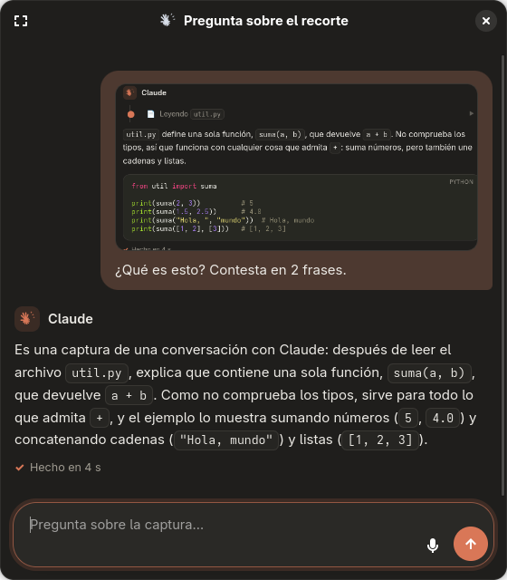
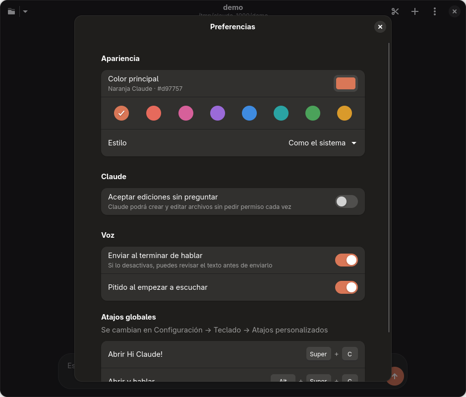

<p align="center"></p>

<h1 align="center">Hi Claude!</h1>

<p align="center"><b>Claude Code en una ventana de escritorio</b>: legible, sin aspecto de terminal, con <b>voz</b> y <b>recortes de pantalla</b>.</p>


## Tres atajos

| Linux | Windows | Qué hace |
|---|---|---|
| **Super + C** | **Win + Alt + C** | Abre Hi Claude! |
| **Super + Alt + C** | **Win + Alt + V** | Abre Hi Claude! **escuchando**: hablas, haces una pausa y se envía |
| **Ctrl + Super + C** | **Win + Alt + X** | **Recorte**: seleccionas un trozo de pantalla con el ratón y, al soltar, se abre una ventanita para preguntarle a Claude por él |

> En Windows, Win + C y Ctrl + Win + C los reserva el sistema (Copilot y filtros de color): por eso se usa Win + Alt. Se pueden cambiar en `config.toml`.

<p align="center"> &nbsp; </p>

- **Es el mismo Claude Code de la terminal**: tu sesión, tu `CLAUDE.md` y tus permisos, a través del [Claude Agent SDK](https://github.com/anthropics/claude-agent-sdk-python).
- **Respuestas legibles**: el texto aparece mientras Claude escribe, con tablas y código coloreado.
- **Lo que hace Claude, a la vista**: una línea de tiempo con «Leyendo…», «Editando…» (los cambios en rojo y verde) y «Ejecutando…».
- **Permisos**: un diálogo con **Permitir / Permitir siempre / Denegar** cada vez que quiere cambiar algo.
- **Color principal personalizable**: naranja Claude por defecto, 8 colores predefinidos o el que quieras. Modo claro, oscuro o el del sistema.
- **La voz se transcribe en tu PC** con [faster-whisper](https://github.com/SYSTRAN/faster-whisper) (en la GPU NVIDIA si hay). El micrófono solo se abre mientras escuchas.
- **Nada en segundo plano**: al cerrar la ventana no queda nada funcionando.

| Plataforma | Estado |
|---|---|
| Linux (GNOME, Wayland o X11) | ✅ [`linux/`](linux/) · 📘 [docs/MANTENIMIENTO.md](docs/MANTENIMIENTO.md) |
| Windows 10 / 11 | ✅ [`windows/`](windows/) · 📘 [docs/MANTENIMIENTO-WINDOWS.md](docs/MANTENIMIENTO-WINDOWS.md) |

> **Versiones anteriores**:
> - [`v2-oye-claude`](https://github.com/9Dariuss/hi-claude/tree/v2-oye-claude): la app con el nombre «Oye Claude».
> - [`v1-tmux`](https://github.com/9Dariuss/hi-claude/tree/v1-tmux): un daemon que escuchaba siempre «Oye Claude» y escribía en la terminal con tmux.

---

## Instalación (Windows)

### 1. Requisitos

- **Python 3.11 o más reciente** desde [python.org](https://www.python.org/downloads/) (o `winget install Python.Python.3.13`).
- Nada más: el motor web (Edge WebView2) ya viene con Windows 10/11, y Claude Code va incluido en la app. Si ya tienes `claude` instalado, usa ese.

### 2. Instalar

1. Descarga el repositorio (botón **Code → Download ZIP** en GitHub, o `git clone https://github.com/9Dariuss/hi-claude.git`).
2. Abre la carpeta `windows` y haz **doble clic en `Instalar Hi Claude.cmd`**.

El instalador (no pide permisos de administrador):

1. copia la app a `%LOCALAPPDATA%\hi-claude\` con su propio entorno de Python;
2. si hay GPU NVIDIA, instala cuBLAS y cuDNN dentro del entorno;
3. descarga el modelo de Whisper (`small`, ~480 MB);
4. si Claude Code no tiene la sesión iniciada, abre el navegador para iniciarla (solo la primera vez);
5. crea **Hi Claude!** y **Hi Claude! (recorte)** en el menú Inicio, con su icono;
6. activa los tres atajos globales: un proceso diminuto que arranca con Windows y espera dormido (sin CPU ni micrófono). Usa `-NoShortcuts` para no crear accesos directos ni atajos;
7. añade el comando `hi-claude` a tu PATH (`hi-claude C:\mi-proyecto`).

Para actualizar, vuelve a ejecutarlo. Para desinstalar: `powershell -ExecutionPolicy Bypass -File windows\desinstalar.ps1`.

### 3. Usar

Igual que en Linux (tabla de abajo), con los atajos de Windows. El botón ✂ de la ventana también recorta.

---

## Instalación (Linux)

### 1. Requisitos

```bash
sudo pacman -S --needed python python-gobject gtk4 libadwaita webkitgtk-6.0 portaudio
```

(Debian/Ubuntu 24.04+: `sudo apt install python3-venv python3-gi gir1.2-adw-1 gir1.2-webkit-6.0 libportaudio2`)

Y Claude Code instalado y con la sesión iniciada (ejecuta `claude` una vez en la terminal):

```bash
curl -fsSL https://claude.ai/install.sh | bash
```

### 2. Instalar

```bash
git clone https://github.com/9Dariuss/hi-claude.git ~/hi-claude
```

```bash
~/hi-claude/linux/install.sh
```

El instalador:

1. copia la app a `~/.local/share/hi-claude/` con su propio entorno de Python;
2. crea el comando `hi-claude` en `~/.local/bin/`;
3. añade **Hi Claude!** al menú de aplicaciones, con su icono;
4. si usas el tema de iconos **YAMIS**, instala también la variante monocroma del icono;
5. si hay GPU NVIDIA, instala cuBLAS y cuDNN dentro del entorno (sin tocar el sistema);
6. descarga el modelo de Whisper (`small`, ~480 MB);
7. configura los tres atajos de GNOME. Si ya existe uno con la misma combinación, lo reutiliza. Usa `--no-shortcuts` para no tocarlos;
8. si tenías «Oye Claude», lo migra: reutiliza el entorno, tu configuración y tus atajos.

> **La primera vez que uses el recorte**, GNOME pregunta si permites que la app haga capturas de pantalla. Acepta: después ya no vuelve a preguntar.

### 3. Usar

| Acción | Cómo |
|---|---|
| Hablar | **Super + Alt + C**, el botón 🎙 o **Ctrl + M**. Para terminar, haz una pausa o vuelve a pulsar 🎙 |
| Recortar | **Ctrl + Super + C** o el botón ✂ de la ventana. Arrastra, suelta y escribe la pregunta. **Esc** cancela |
| Seguir un recorte en grande | Botón ⛶ de la ventanita: la conversación pasa a la ventana principal |
| Enviar texto | **Intro** (Mayús + Intro para una nueva línea) |
| Detener a Claude | **Esc** o el botón ⏹ |
| Cambiar de proyecto | Botón 📁 (la flecha muestra los recientes) o **Ctrl + O** |
| Nueva conversación | Botón ＋ o **Ctrl + N** |
| Color y tema | Menú ⋮ → **Preferencias** (**Ctrl + ,**) |
| Abrir en una carpeta | `hi-claude ~/mi-proyecto` (o `hi-claude .`) |

---

## Cómo funciona

```
 Super+C / Super+Alt+C ──► hi-claude [--voice] ─┐
 Ctrl+Super+C ──────────► hi-claude --snip ─────┤  una sola instancia (D-Bus):
                                                ▼  la segunda llamada solo avisa a la primera
                     ┌──────────── App (GTK4 + libadwaita) ────────────┐
   portal Screenshot ─► captura congelada a pantalla completa por monitor ─► selección
                     │                                    ▼
                     │  ventana principal        ventana rápida (recorte)
                     │      └── ChatView (WebKit) + Composer (texto/🎙) ──┘
                     └────────────── ChatController ───────────────────┘
                                          │  (hilo asyncio)
                                Claude Agent SDK ─► claude CLI
```

- **Windows**: la misma lógica (`claude.py`, `render.py`, `voice.py`, el controlador del chat) con otra ventana: **pywebview** (Edge WebView2) carga una versión de `chat.html` que incluye también la cabecera, el cuadro de texto, los permisos y las Preferencias. La barra de título toma el color del tema. El recorte se hace con `mss` y una ventana tkinter por monitor, en un proceso aparte; la instancia única usa un mutex y una *named pipe*.
- **Interfaz (Linux)**: GTK 4 + libadwaita, con una paleta cálida propia y el color principal aplicado a toda la interfaz (variables CSS `--accent-bg-color`). La conversación se dibuja en WebKitGTK con HTML/CSS: Markdown con `markdown-it-py` (el HTML que escriba Claude se muestra como texto, nunca se ejecuta) y coloreado de código con Pygments.
- **Claude**: `ClaudeSDKClient` en un hilo con asyncio, con streaming. Lanza el mismo `claude` de la terminal con `setting_sources = user, project, local`. Las imágenes del recorte se envían como bloques `image` en base64, a un máximo de 1568 px por lado.
- **Recorte**: el portal de escritorio (`org.freedesktop.portal.Screenshot`, no interactivo) captura todos los monitores. La captura se muestra congelada en una ventana a pantalla completa por monitor, se selecciona con el ratón y se recorta en memoria. El archivo temporal que crea el portal se borra. Los últimos 20 recortes quedan en `~/.cache/hi-claude/recortes/`.
- **Voz**: el micrófono se abre al pulsar. Un VAD por energía detecta cuándo dejas de hablar, y Whisper `small` transcribe. Hay un único modelo en memoria aunque haya dos ventanas.

## Ajustes

- **Lo habitual** (color, tema, aceptar ediciones, opciones de voz) se cambia en **Preferencias** dentro de la app.
- **Lo técnico** va en `~/.config/hi-claude/config.toml` en Linux y en `%APPDATA%\hi-claude\config.toml` en Windows (ver [`linux/config.example.toml`](linux/config.example.toml) y [`windows/config.example.toml`](windows/config.example.toml); en Windows, Preferencias → **Abrir config.toml**):

| Clave | Para qué |
|---|---|
| `input_device` | Elegir micrófono (lista: `hi-claude --list-mics`) |
| `model` | `large-v3-turbo` entiende mejor (con GPU va rápido; +1,6 GB) |
| `end_silence_ms` | Pausa que da por terminada la orden (1300 ms) |
| `vad_margin_db` | Súbelo si corta mal con ruido; bájalo si no te oye |
| `device` | `auto` (GPU si hay), `cuda` o `cpu` |
| `default_project` | Carpeta de la primera vez (luego recuerda la última) |
| `hotkey_open`, `hotkey_voice`, `hotkey_snip` | Solo Windows: los atajos globales (p. ej. `"Win+Alt+C"`) |

## El icono

Un estallido de rayos (al estilo del logo de Claude, pero original) cuyos rayos largos forman una **mano saludando**. Hay dos versiones en [`linux/data/icons/`](linux/data/icons/):
- la normal, naranja sobre crema;
- una monocroma para el tema de iconos YAMIS.

Las dos salen de `generar_iconos.py`.

> Claude y su logo son marcas de Anthropic. Este es un proyecto personal no oficial.

## Problemas frecuentes

Guía completa: **[docs/MANTENIMIENTO.md](docs/MANTENIMIENTO.md)**.

- **Tras `pacman -Syu` no abre** → ejecuta `~/hi-claude/linux/install.sh` (rehace el entorno si cambió Python).
- **El recorte no hace nada** → acepta el permiso de capturas de GNOME, o mira los errores ejecutando `hi-claude --snip` en una terminal.
- **Ver errores** → ejecuta `hi-claude` desde una terminal.

## Estructura

```
linux/
  hi_claude/
    app.py          ventana principal, Preferencias, atajos, instancia única
    chat.py         ChatView (WebKit), Composer (texto + voz), ChatController (Claude + permisos)
    snip.py         recorte: portal de capturas, selección en pantalla, ventana rápida
    theme.py        color principal y paleta clara/oscura
    claude.py       puente con el Claude Agent SDK (hilo asyncio, imágenes, retomar sesión)
    render.py       Markdown → HTML, descripción de herramientas
    voice.py        micrófono, VAD y faster-whisper
    config.py       configuración (TOML) y preferencias (JSON)
    chat.html       vista de la conversación (CSS + JS)
    hand.svg        la mano del icono, para el avatar del chat
  data/             entrada .desktop e iconos (normal + YAMIS + generador)
  install.sh        instalador (y migración desde «Oye Claude»)
windows/
  hi_claude/
    app.py          ventanas (principal y recorte) con pywebview, Preferencias, instancia única
    chat.py         ChatView (puente con JS), voz del cuadro de texto, ChatController (Claude + permisos)
    chat.html       la interfaz entera: cabecera, conversación, cuadro de texto, diálogos y Preferencias
    snip_overlay.py selección del recorte a pantalla completa (mss + tkinter, proceso aparte)
    hotkeys.py      atajos globales con RegisterHotKey (`--atajos`, arranca con Windows)
    instance.py     instancia única: mutex + named pipe
    mainloop.py     hilo «principal» de la interfaz (como el bucle de GLib)
    winutil.py      icono, barra de título del color del tema, parpadeo, portapapeles
    claude.py, render.py, voice.py, config.py   los de Linux, adaptados
  data/generar_ico.py   genera hi-claude.ico con el mismo dibujo
  install.ps1, Instalar Hi Claude.cmd, desinstalar.ps1
docs/
  MANTENIMIENTO.md          guía paso a paso (Linux)
  MANTENIMIENTO-WINDOWS.md  guía paso a paso (Windows)
  MEMORIA-WINDOWS.md        contexto y lecciones del port a Windows
```

## Licencia

MIT
