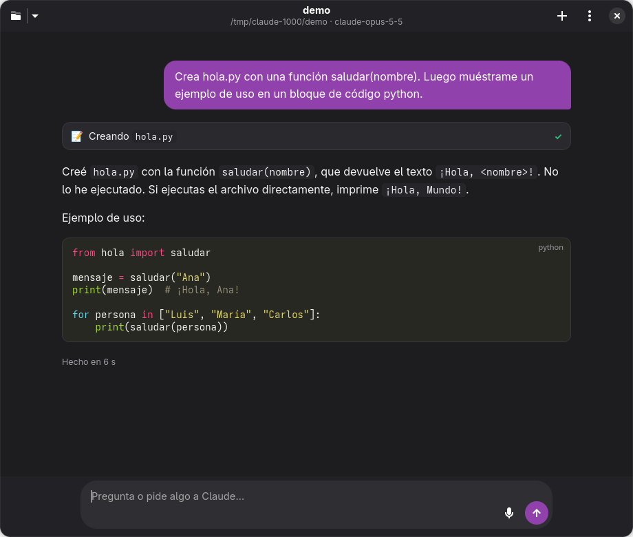

# 🎙️ Oye Claude

**Claude Code en una ventana de escritorio**, legible y sin aspecto de terminal, con **entrada por voz** al pulsar un atajo.



- **Super + C** → abre Oye Claude.
- **Super + Alt + C** → abre Oye Claude **escuchando**: dices lo que quieres, haces una pausa y se envía.
- Respuestas con formato (tablas, código coloreado), tarjetas que resumen lo que hace Claude («Leyendo…», «Editando…», «Ejecutando…») y diálogos para permitir o denegar cambios.
- Es el mismo Claude Code de la terminal (usa tu sesión, tu `CLAUDE.md` y tus permisos) a través del [Claude Agent SDK](https://github.com/anthropics/claude-agent-sdk-python).
- La voz se transcribe **en tu PC** con [faster-whisper](https://github.com/SYSTRAN/faster-whisper) (en la GPU NVIDIA si hay). No se envía audio a ningún sitio, y el micrófono **solo se abre mientras escuchas**: nada se queda en segundo plano.

| Plataforma | Estado |
|---|---|
| Linux (GNOME, Wayland o X11) | ✅ [`linux/`](linux/) |
| Mantenimiento y diagnóstico | 📘 [docs/MANTENIMIENTO.md](docs/MANTENIMIENTO.md) |
| Windows | 🛠️ pendiente — ver [docs/MEMORIA-WINDOWS.md](docs/MEMORIA-WINDOWS.md) |

> La versión 1 (daemon siempre escuchando «Oye Claude» + tmux) está en la etiqueta [`v1-tmux`](https://github.com/9Dariuss/oye-claude/tree/v1-tmux).

---

## Instalación (Linux)

### 1. Requisitos

```bash
sudo pacman -S --needed python python-gobject gtk4 libadwaita webkitgtk-6.0 portaudio
```

(Debian/Ubuntu 24.04+: `sudo apt install python3-venv python3-gi gir1.2-adw-1 gir1.2-webkit-6.0 libportaudio2`)

Y Claude Code instalado y con la sesión iniciada (ejecuta `claude` una vez en la terminal):

```bash
curl -fsSL https://claude.ai/install.sh | bash
```

### 2. Instalar

```bash
git clone https://github.com/9Dariuss/oye-claude.git ~/oye-claude
```

```bash
~/oye-claude/linux/install.sh
```

El instalador:

1. copia la app a `~/.local/share/oye-claude/` con su propio entorno de Python;
2. crea el comando `oye-claude` en `~/.local/bin/`;
3. añade **Oye Claude** al menú de aplicaciones, con su icono;
4. si hay GPU NVIDIA, instala cuBLAS y cuDNN dentro del entorno (sin tocar el sistema);
5. descarga el modelo de Whisper (`small`, ~480 MB);
6. configura los atajos de GNOME **Super+C** y **Super+Alt+C**. Si ya tenías un atajo en Super+C, lo reutiliza. Usa `--no-shortcuts` para no tocarlos;
7. si tenías la versión 1, retira su servicio en segundo plano.

### 3. Usar

| Acción | Cómo |
|---|---|
| Abrir | **Super + C**, el menú de aplicaciones o `oye-claude` |
| Hablar | **Super + Alt + C** (con la app cerrada o abierta), el botón 🎙 o **Ctrl + M** |
| Terminar de hablar | Haz una pausa de ~1,3 s, o pulsa 🎙 otra vez |
| Enviar texto | **Intro** (Mayús + Intro para una nueva línea) |
| Detener a Claude | **Esc** o el botón ⏹ |
| Cambiar de proyecto | Botón 📁 (la flecha muestra los recientes) o **Ctrl + O** |
| Nueva conversación | Botón ＋ o **Ctrl + N** |
| Abrir en una carpeta | `oye-claude ~/mi-proyecto` (o `oye-claude .`) |

Cuando Claude quiera **editar archivos o ejecutar comandos**, aparece un diálogo con **Permitir**, **Permitir siempre** (en esta conversación) o **Denegar**. Leer archivos y buscar no piden permiso. En el menú ⋮ puedes activar **Aceptar ediciones sin preguntar**.

Si dices «Oye Claude, …» por costumbre, la app quita esas palabras antes de enviar.

---

## Cómo funciona

```
 Super+Alt+C ──► oye-claude --voice ──► (si ya está abierta, la misma ventana)
                                              │
 🎙 micrófono ──► VAD por energía ──► frase ──► faster-whisper (GPU/CPU) ──► texto
                                                                              │
 ventana GTK4/Adwaita ◄── HTML (WebKit) ◄── eventos ◄── Claude Agent SDK ◄────┘
        │                                                  (claude CLI)
        └── diálogos de permiso ──► can_use_tool ──────────────┘
```

- **Interfaz**: GTK 4 + libadwaita (aspecto nativo de GNOME, modo oscuro y color de acento del sistema). La conversación se dibuja en WebKitGTK con HTML/CSS: Markdown con `markdown-it-py` y coloreado de código con Pygments. El HTML que escriba Claude se muestra como texto, nunca se ejecuta.
- **Claude**: `ClaudeSDKClient` del Agent SDK en un hilo con asyncio, con streaming (`include_partial_messages`) para ver el texto mientras se escribe. Lanza el mismo `claude` de la terminal con `setting_sources = user, project, local`.
- **Una sola instancia**: `Gtk.Application` con D-Bus. El atajo de voz vuelve a llamar a `oye-claude --voice`, y esa segunda llamada solo le dice a la ventana abierta que escuche.
- **Voz**: el micrófono se abre al pulsar. Un VAD por energía (ruido de fondo = percentil 15) detecta cuándo dejas de hablar, y Whisper `small` transcribe con el filtro Silero VAD. El modelo se carga mientras ya estás hablando.

## Ajustes

`~/.config/oye-claude/config.toml` (ver [`linux/config.example.toml`](linux/config.example.toml)). Tras cambiarlo, cierra y abre la app.

| Clave | Para qué |
|---|---|
| `input_device` | Elegir micrófono (lista: `oye-claude --list-mics`) |
| `model` | `large-v3-turbo` entiende mejor (con GPU va rápido; +1,6 GB) |
| `auto_send` | `false` para revisar el texto dictado antes de enviarlo |
| `end_silence_ms` | Pausa que da por terminada la orden (1300 ms) |
| `vad_margin_db` | Súbelo si corta mal con ruido; bájalo si no te oye |
| `device` | `auto` (GPU si hay), `cuda` o `cpu` |
| `default_project` | Carpeta de la primera vez (luego recuerda la última) |

## Problemas frecuentes

Guía completa: **[docs/MANTENIMIENTO.md](docs/MANTENIMIENTO.md)**.

- **Tras `pacman -Syu` no abre** → ejecuta `~/oye-claude/linux/install.sh` (rehace el entorno si cambió Python).
- **Ver errores** → ejecuta `oye-claude` desde una terminal y mira lo que imprime.
- **Claude dice que no has iniciado sesión** → abre `claude` una vez en la terminal e inicia sesión.

## Estructura

```
linux/
  oye_claude/
    app.py          ventana GTK/Adwaita, atajos, permisos, voz
    claude.py       puente con el Claude Agent SDK (hilo asyncio)
    render.py       Markdown → HTML, descripción de herramientas
    chat.html       vista de la conversación (CSS + JS)
    voice.py        micrófono, VAD y faster-whisper
    config.py       configuración y estado
  data/             icono y entrada .desktop
  install.sh        instalador
  config.example.toml
  requirements.txt  requirements-gpu.txt
docs/
  MANTENIMIENTO.md  guía paso a paso
  MEMORIA-WINDOWS.md  contexto para portarlo a Windows con Claude
```

## Licencia

MIT
